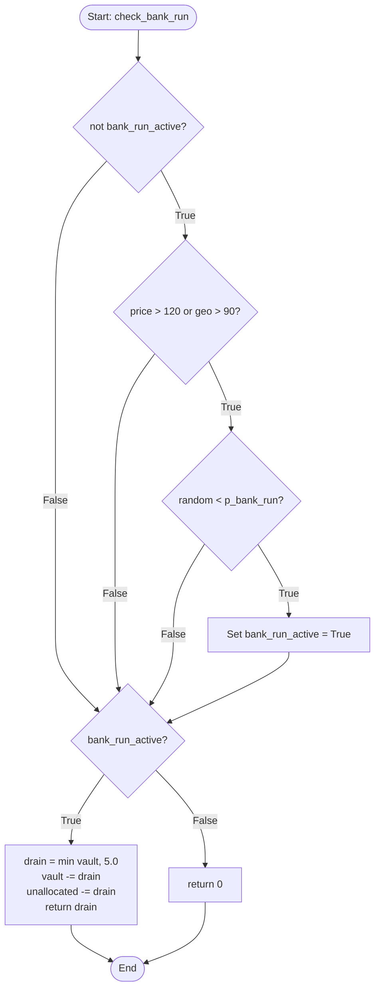

# ISO/IEC/IEEE 29119-4 Test Design Specification
**Document Identifier:** TDS-ISO-29119-WB-001  
**Standard Reference:** ISO/IEC/IEEE 29119-4:2015 / 2021 (Clause 7: White-Box Test Design Techniques)  
**Parent Document:** [ISO_29119_4_TEST_PLAN.md](file:///c:/Users/Dell/Downloads/silver%20analisis/QA%20whitebox/docs/ISO_29119_4_TEST_PLAN.md)  
**System Under Test:** Silver Analisis Simulation Engine (`src/`)  

---

## 1. Scope & Objective

This specification details the formal structural test models, Control Flow Graphs (CFG), Cyclomatic Complexity metrics ($V(G)$), Basis Paths, Modified Condition/Decision Coverage (MC/DC) truth tables, and Data Flow Def-Use (DU) pairs required by **ISO/IEC/IEEE 29119-4 Clause 7**.

---

## 2. Cyclomatic Complexity ($V(G)$) & Control Flow Analysis

McCabe's Cyclomatic Complexity is defined as:
$$V(G) = E - N + 2P = D + 1$$
where $E$ is the number of edges, $N$ is the number of nodes, $P$ is connected components, and $D$ is the number of binary decision points.

### 2.1 Component Complexity Inventory (via Radon)

```
================================================================================
Module                  Function / Method                             V(G)  Risk
================================================================================
src/macro.py            MacroEnvironment.simulate_day                   43  Grade F
src/engine.py           SimulationEngine._process_demand                33  Grade E
src/engine.py           SimulationEngine._update_exchanges_and_stats    32  Grade E
src/engine.py           SimulationEngine._update_price                  18  Grade C
src/stakeholders.py     SolarPV.process_day                             16  Grade C
src/engine.py           SimulationEngine.run                            16  Grade C
src/stakeholders.py     Gov_China.process_day                           13  Grade C
src/stakeholders.py     PrimaryMiners.process_day                       12  Grade C
src/stakeholders.py     ExchangeMarginControls.process_day              12  Grade C
src/macro.py            LiveDataOracle.fetch_live_data                  12  Grade C
src/stakeholders.py     PredatoryHedgeFund.process_attack               11  Grade C
src/stakeholders.py     DeepPrivateHoarders.process_day                 10  Grade B
src/config.py           SimConfig.from_yaml                              9  Grade B
src/exchanges.py        LBMA_Exchange.check_bank_run                     6  Grade B
================================================================================
Average System Complexity: 5.13 (Grade B)
```

---

## 3. Modified Condition/Decision Coverage (MC/DC) Specifications

Per **ISO/IEC/IEEE 29119-4 Clause 7.6**, for every compound decision containing $N$ Boolean atomic conditions, at least $N+1$ test cases must be specified. Each atomic condition must be demonstrated to independently affect the decision outcome by holding all other conditions constant (or masked).

### 3.1 Decision 1: LBMA Bank Run Trigger (`src/exchanges.py:30`)
- **Decision:** $D_1 = \neg A \land (B \lor C)$
  - Condition $A$: `self.bank_run_active`
  - Condition $B$: `price > 120.0`
  - Condition $C$: `geo_tension > 90.0`

#### Truth Table & Independence Pairs:
| Test ID | Condition $A$ (`bank_run_active`) | Condition $B$ (`price > 120`) | Condition $C$ (`geo_tension > 90`) | Decision $D_1$ Outcome | Independence Pair Role |
|---|---|---|---|---|---|
| **MCDC-D1-01** | False | True | False | **TRUE** | Base case for $A$ and $B$ |
| **MCDC-D1-02** | True | True | False | **FALSE** | **Pair with 01 for Condition $A$** |
| **MCDC-D1-03** | False | False | False | **FALSE** | **Pair with 01 for Condition $B$** |
| **MCDC-D1-04** | False | False | True | **TRUE** | Base case for $C$ |
| **MCDC-D1-05** | False | False | False | **FALSE** | **Pair with 04 for Condition $C$** |

*Result:* 4 unique test vectors (`01`, `02`, `03`, `04`) provide complete MC/DC coverage for $D_1$ ($N=3 \implies 4$ tests).

---

### 3.2 Decision 2: India IIBX LBMA Drain Pipeline (`src/exchanges.py:65`)
- **Decision:** $D_2 = \neg A \land \neg B$
  - Condition $A$: `macro.export_ban_active`
  - Condition $B$: `macro.supply_chain_blockade`

#### Truth Table & Independence Pairs:
| Test ID | Condition $A$ (`export_ban`) | Condition $B$ (`supply_chain_blockade`) | Decision $D_2$ Outcome | Independence Pair Role |
|---|---|---|---|---|
| **MCDC-D2-01** | False | False | **TRUE** | Nominal active drain (LBMA drain executed) |
| **MCDC-D2-02** | True | False | **FALSE** | **Pair with 01 for Condition $A$** (Ban halts drain) |
| **MCDC-D2-03** | False | True | **FALSE** | **Pair with 01 for Condition $B$** (Blockade halts drain) |

*Result:* Exactly $N+1 = 3$ test vectors guarantee MC/DC for $D_2$.

---

### 3.3 Decision 3: COMEX Eligible to Registered Transfer (`src/exchanges.py:13`)
- **Decision:** $D_3 = A \land B$
  - Condition $A$: `current_price > threshold_price`
  - Condition $B$: `self.eligible_float > amount`

#### Truth Table & Independence Pairs:
| Test ID | Condition $A$ (`price > threshold`) | Condition $B$ (`eligible > amount`) | Decision $D_3$ Outcome | Independence Pair Role |
|---|---|---|---|---|
| **MCDC-D3-01** | True | True | **TRUE** | Transfer approved & executed |
| **MCDC-D3-02** | False | True | **FALSE** | **Pair with 01 for Condition $A$** |
| **MCDC-D3-03** | True | False | **FALSE** | **Pair with 01 for Condition $B$** |

---

### 3.4 Decision 4: SGE Asian Arbitrage Vault Drain (`src/exchanges.py:87`)
- **Decision:** $D_4 = A \land B$
  - Condition $A$: `self.east_west_spread > shipping_insurance_cost` ($0.50$)
  - Condition $B$: `vault_float > 0`

#### Truth Table & Independence Pairs:
| Test ID | Condition $A$ (`spread > 0.50`) | Condition $B$ (`vault_float > 0`) | Decision $D_4$ Outcome | Independence Pair Role |
|---|---|---|---|---|
| **MCDC-D4-01** | True (0.80) | True (100.0) | **TRUE** | Arbitrage drain triggered |
| **MCDC-D4-02** | False (0.30) | True (100.0) | **FALSE** | **Pair with 01 for Condition $A$** (Spread too low) |
| **MCDC-D4-03** | True (0.80) | False (0.0) | **FALSE** | **Pair with 01 for Condition $B$** (Vault depleted) |

---

### 3.5 Decision 5: Base Metal Recession Shock (`src/macro.py:161`)
- **Decision:** $D_5 = A \land B$
  - Condition $A$: `self.dxy_strength > 105`
  - Condition $B$: `self.global_gdp_growth < 0`

#### Truth Table & Independence Pairs:
| Test ID | Condition $A$ (`dxy > 105`) | Condition $B$ (`gdp_growth < 0`) | Decision $D_5$ Outcome | Independence Pair Role |
|---|---|---|---|---|
| **MCDC-D5-01** | True (108.0) | True (-0.02) | **TRUE** | Base metal recession active |
| **MCDC-D5-02** | False (98.0) | True (-0.02) | **FALSE** | **Pair with 01 for Condition $A$** |
| **MCDC-D5-03** | True (108.0) | False (+0.03) | **FALSE** | **Pair with 01 for Condition $B$** |

---

### 3.6 Decision 6: Dual Default Force Majeure (`src/engine.py:528`)
- **Decision:** $D_6 = A \land B \land \neg C$
  - Condition $A$: `comex.defaulted`
  - Condition $B$: `lbma.defaulted`
  - Condition $C$: `comex.force_majeure_active`

#### Truth Table & Independence Pairs:
| Test ID | Condition $A$ (`comex_def`) | Condition $B$ (`lbma_def`) | Condition $C$ (`fm_active`) | Decision $D_6$ Outcome | Independence Pair Role |
|---|---|---|---|---|---|
| **MCDC-D6-01** | True | True | False | **TRUE** | Bailout evaluation triggered |
| **MCDC-D6-02** | False | True | False | **FALSE** | **Pair with 01 for Condition $A$** |
| **MCDC-D6-03** | True | False | False | **FALSE** | **Pair with 01 for Condition $B$** |
| **MCDC-D6-04** | True | True | True | **FALSE** | **Pair with 01 for Condition $C$** |

*Result:* Exactly $N+1 = 4$ test vectors provide full independence coverage for $D_6$.

---

## 4. Basis Path Testing & Control Flow Graphs (CFG)

### 4.1 CFG for `LBMA_Exchange.check_bank_run` ($V(G) = 6$)



#### Linearly Independent Basis Path Set:
- **Path 1 (Inactive, no panic):** $N1 \to N2(\text{True}) \to N3(\text{False}) \to N6(\text{False}) \to N8 \to N9$ (Returns 0)
- **Path 2 (Already active):** $N1 \to N2(\text{False}) \to N6(\text{True}) \to N7 \to N9$ (Returns drain)
- **Path 3 (Panic price, RNG misses):** $N1 \to N2(\text{True}) \to N3(\text{True}) \to N4(\text{False}) \to N6(\text{False}) \to N8 \to N9$ (Returns 0)
- **Path 4 (Panic geo, RNG hits):** $N1 \to N2(\text{True}) \to N3(\text{True}) \to N4(\text{True}) \to N5 \to N6(\text{True}) \to N7 \to N9$ (Activates and returns drain)
- **Path 5 (Vault empty when active):** $N1 \to N2(\text{False}) \to N6(\text{True}) \to N7(\text{vault}=0) \to N9$ (Drain is 0, claims unchanged)

---

## 5. Data Flow Testing Specifications (Clause 7.7)

Data Flow Testing tracks variable lifecycle: **Definition ($d$)**, **Computation-Use ($c$)**, **Predicate-Use ($p$)**, and **Kill ($k$)**.

### 5.1 Critical State Variables & DU-Pair Matrix

| Variable | Definition Line(s) | Predicate-Use ($p$-use) | Computation-Use ($c$-use) | Target Test Identifier |
|---|---|---|---|---|
| `self.physical_price` | `engine.py:32`, `engine.py:450`, `macro.py:46` | `engine.py:155`, `engine.py:211`, `engine.py:247`, `engine.py:365`, `engine.py:478`, `engine.py:539` | `engine.py:150`, `engine.py:187`, `engine.py:204`, `engine.py:248`, `engine.py:450`, `engine.py:521` | **DFT-PHYS-PRICE-01..05** |
| `self.paper_price` | `engine.py:33`, `engine.py:420` | `engine.py:420`, `stakeholders.py:580` | `engine.py:217`, `engine.py:420`, `engine.py:450` | **DFT-PAPER-PRICE-01..03** |
| `comex.vault_float` | `exchanges.py:7`, `exchanges.py:15`, `engine.py:490`, `engine.py:512` | `engine.py:335`, `engine.py:478`, `engine.py:489`, `engine.py:497` | `engine.py:235`, `engine.py:244`, `engine.py:350`, `engine.py:489`, `engine.py:514` | **DFT-COMEX-VAULT-01..06** |
| `lbma.vault_float` | `exchanges.py:22`, `exchanges.py:38`, `engine.py:491`, `engine.py:524` | `engine.py:488`, `engine.py:492`, `engine.py:516` | `engine.py:235`, `engine.py:238`, `engine.py:241`, `engine.py:350`, `engine.py:494`, `engine.py:526` | **DFT-LBMA-VAULT-01..06** |
| `self.physical_premium`| `engine.py:34`, `engine.py:441`, `engine.py:444` | `engine.py:444` | `engine.py:441`, `engine.py:450` | **DFT-PREMIUM-01..03** |
| `sge.east_west_spread` | `exchanges.py:73`, `exchanges.py:80`, `exchanges.py:85` | `exchanges.py:87` | `exchanges.py:88` | **DFT-SGE-SPREAD-01..04** |

---

## 6. Execution Traceability

Every test case in the `QA whitebox/` test suite strictly maps back to the identifiers and coverage items cataloged in this specification. Bi-directional traceability is maintained in [ISO_29119_4_TRACEABILITY_MATRIX.md](file:///c:/Users/Dell/Downloads/silver%20analisis/QA%20whitebox/docs/ISO_29119_4_TRACEABILITY_MATRIX.md).
